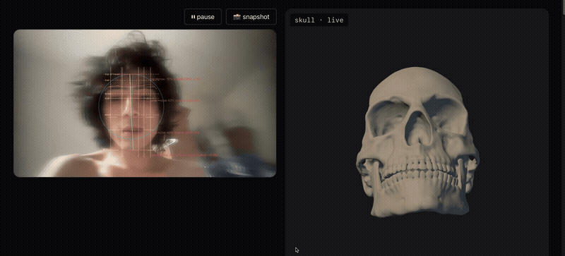

# drawloom

Upload a portrait for direct landmark traces, a face-mesh wireframe, value reduction, measurement guides, and shape studies. Runs in-browser, no backend, no upload.

[Open Drawloom](https://rikiworld.com/drawloom/)



## Overlays

| Overlay | Category |
|---|---|
| Face-oval landmark trace | Construction |
| Face centerline landmark trace | Construction |
| MediaPipe face-mesh wireframe | Structure |
| Eye-line + plumb + thirds grid | Geometry |
| Notan (2/3-value reduction) | Value |
| Edge map / squint / silhouette | Shape |

The default layout places the portrait/webcam beside a 3D skull reference at the detected head angle. The skull is deliberately separate; Drawloom does not claim anatomical registration to the subject.

Webcam mode also includes a guided five-angle capture. It checks measurable pose, framing, even lighting, image sharpness, facial motion, and a relaxed expression before automatically storing each clean camera frame. Overlays are not baked into the captured set.

Overlays live in `src/lib/overlays/`. Add one by exporting an `Overlay` and registering it in `registry.ts`.

## Stack

Next.js 16 + React 19 + TypeScript, Tailwind v4, `@mediapipe/tasks-vision` Face Landmarker, Zustand.

## Run

```bash
npm install
npm run dev
```

Open http://localhost:3000/drawloom/.

## Roadmap

- Validate landmark-derived guides across front, three-quarter, and profile views
- Improve skull comparison framing without implying anatomical registration
- Add new construction or anatomy aids only with a cited model and visual validation set

## License

MIT
