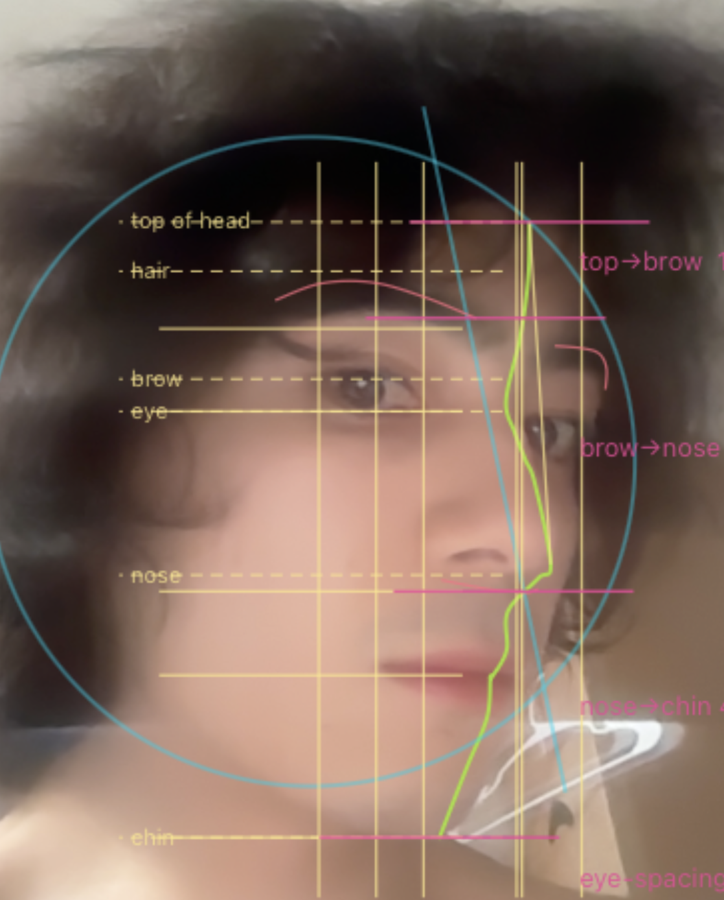
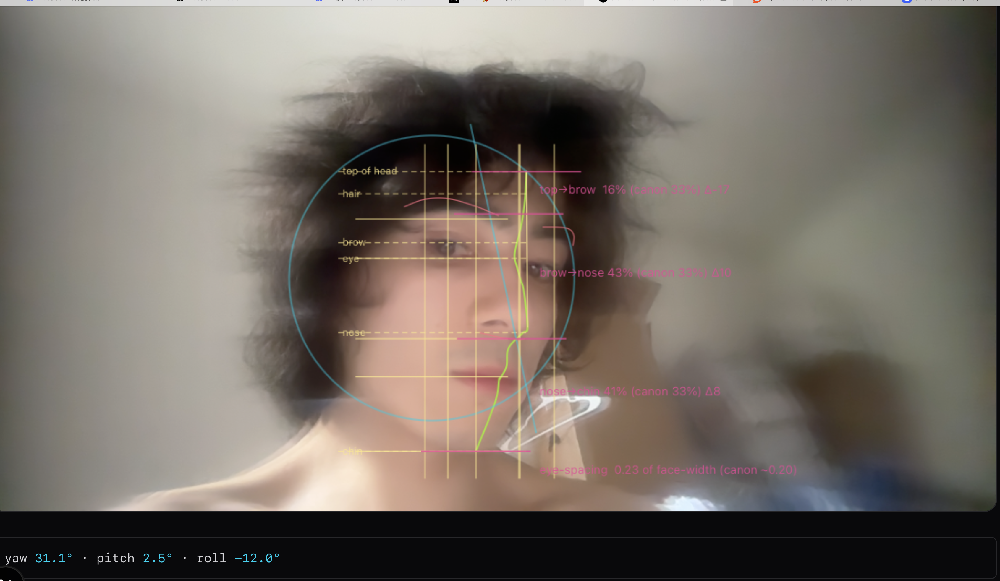

# drawloom

Upload a portrait, get construction/anatomy/value overlays for study. Runs in-browser, no backend, no upload.

[Open Drawloom](https://rikiworld.com/drawloom/)





## Overlays

| Overlay | Category |
|---|---|
| Loomis head (sphere + cut-plane) | Construction |
| Skeleton + jaw + eye-sockets | Anatomy |
| Proportion vs Loomis canon | Proportion |
| Horizon + plumb + thirds grid | Geometry |
| Notan (2/3-value reduction) | Value |
| Edge map / squint / silhouette | Shape |
| Skull (3D .glb model) | Anatomy |
| Doveline contour | Construction |
| Feature lines (gullwing lips, brows, jaw) | Anatomy |

Overlays live in `src/lib/overlays/`. Add one by exporting an `Overlay` and registering it in `registry.ts`.

## Stack

Next.js 16 + React 19 + TypeScript, Tailwind v4, `@mediapipe/tasks-vision` Face Landmarker, Zustand.

## Run

```bash
npm install
npm run dev
```

Open http://localhost:3000/drawloom/.

## Roadmap

- Projected 3D Loomis cut-plane geometry
- More accurate Reilly rhythms across front, three-quarter, and profile views
- Better skull scale and portrait matching
- Asaro plane head overlay
- Full muscle layer

## License

MIT
